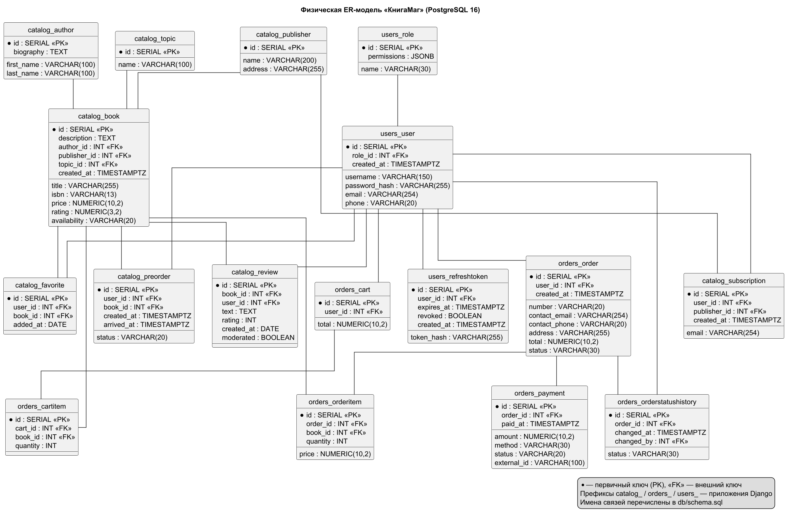

# Схема базы данных

Логическая ER-модель лабораторной работы № 3 уточнена до 17 таблиц и
реализована для **PostgreSQL 16**.

**Физическая ER-диаграмма «КнигаМаг» (PK/FK, типы PostgreSQL)**

- [Логическая схема: Сущность / Таблица БД / Поле / Описание / Тип данных](https://github.com/__OWNER__/__REPO__/blob/main/db/logical-model.md)
- [SQL-файл физической модели: schema.sql](https://github.com/__OWNER__/__REPO__/blob/main/db/schema.sql)
- [Исходный код диаграммы: er_physical.puml](assets/er_physical.puml)

Изменения относительно ЛР 3: добавлены `catalog_preorder` (ФТ-6),
`orders_orderstatushistory` (US-8) и `users_refreshtoken` (UC-11, UC-14);
в `catalog_book` введено `availability`, в `orders_order` разрешён `NULL`
для `user_id` и добавлены контакты гостя (ФТ-5). Все внешние ключи,
ограничения `UNIQUE`/`CHECK` и индексы описаны в `schema.sql`.
