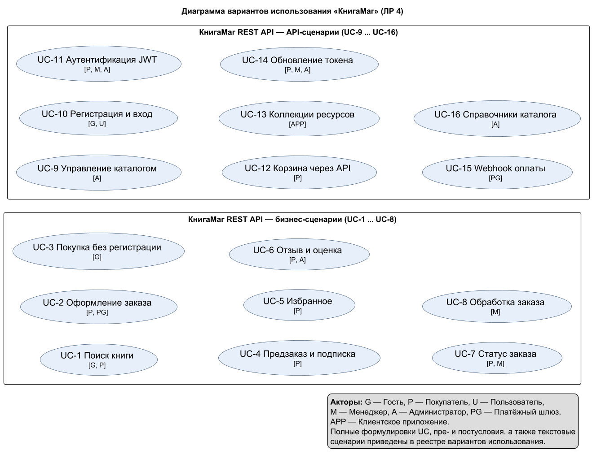

# Функциональные требования

Требования лабораторной работы № 3 (ФТ-1…ФТ-12) сохранены и дополнены
требованиями к REST API: коллекции с пагинацией, JWT-аутентификация,
webhook оплаты, единый формат ошибок, справочники каталога.

| ID | Требование (ЛР 3) |
| --- | --- |
| ФТ-1 | Поиск книг по названию, автору, тематике и издательству, отклик ≤ 2 с |
| ФТ-2 | Фильтрация каталога по цене, тематике, автору, издательству, наличию и рейтингу |
| ФТ-3 | Корзина и избранное; состав корзины сохраняется между сессиями |
| ФТ-4 | Создание заказа и оплата через шлюз со статусом «Оплачен» |
| ФТ-5 | Покупка без регистрации по контактным данным |
| ФТ-6 | Предзаказ книг «Скоро в продаже» и начисление при поступлении тиража |
| ФТ-7 | Подписка на новости издательств с ограничением частоты рассылки |
| ФТ-8 | Просмотр оплаченных заказов и перевод по статусам менеджером |
| ФТ-9 | Отзыв и оценка только для доставленных книг, пересчёт рейтинга |
| ФТ-10 | Управление каталогом администратором с журналированием |
| ФТ-11 | Уведомления о смене статуса заказа и поступлении предзаказа |
| ФТ-12 | Автоматическая отмена неоплаченных заказов через 24 часа |

## Модель требований и реестр вариантов использования

Полная модель «Актор → User Story → Use Case» (US-1…US-16) —
[requirements-model.md](https://github.com/__OWNER__/__REPO__/blob/main/requirements/requirements-model.md);
реестр UC-1…UC-16 — [use-case-registry.md](https://github.com/__OWNER__/__REPO__/blob/main/requirements/use-case-registry.md).

**Диаграмма вариантов использования «КнигаМаг»**

Исходный код диаграммы: [uc_diagram.puml](assets/uc_diagram.puml).

## Текстовые сценарии

### UC-2. Оформление и оплата заказа

**Актор:** Покупатель, платёжный шлюз. **Предусловие:** Корзина не пуста; покупатель авторизован (или выполняется UC-3).

**Основной поток:** 1. POST /api/v1/orders — создание заказа. 2. POST /api/v1/orders/{id}/payment — инициация оплаты. 3. Перенаправление на форму шлюза. 4. POST /api/v1/payments/webhook — подтверждение. 5. Статус «Оплачен», письмо покупателю.

**Альтернативный поток:** Оплата отклонена — статус «Ожидает оплаты», повтор платежа; нет в наличии — предложение предзаказа.

**Результат:** 201/200; создан оплаченный заказ.

### UC-3. Покупка без регистрации

**Актор:** Гость. **Предусловие:** Корзина не пуста; регистрация не выполнена.

**Основной поток:** 1. POST /api/v1/orders/guest с контактами и адресом. 2. Оплата. 3. Получение номера заказа и guest_token.

**Альтернативный поток:** Некорректные данные — 422 с подсветкой полей; желание создать аккаунт — привязка заказа через POST /api/v1/auth/register.

**Результат:** 201; создан заказ без учётной записи.

### UC-4. Предзаказ новинки и подписка

**Актор:** Покупатель. **Предусловие:** Книга в статусе «Скоро в продаже» (availability = preorder).

**Основной поток:** 1. GET /api/v1/books?availability=preorder. 2. POST /api/v1/preorders. 3. POST /api/v1/subscriptions. 4. Поступление тиража — PATCH статуса предзаказа, письмо, оплата.

**Альтернативный поток:** Отмена предзаказа до поступления — DELETE; повторный предзаказ — 409.

**Результат:** 201/204; предзаказ оформлен.
