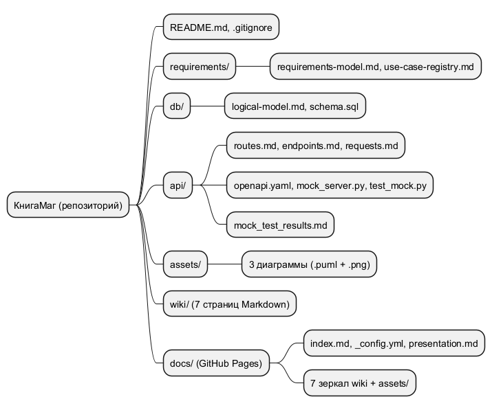

# Диаграмма файлов приложения

**Структура репозитория «КнигаМаг»**

Исходный код диаграммы: [application_files.puml](https://raw.githubusercontent.com/ZAFSNB/knigamag-lab4/main/assets/application_files.puml).

| Каталог / файл | Назначение |
| --- | --- |
| `README.md` | Название, описание, установка, подмодули, использование, авторы |
| `.gitignore` | Исключения для Python/Django/Node и локальных артефактов |
| `requirements/` | Модель требований, реестр UC (задание 1) |
| `db/` | Логическая схема, `schema.sql` (задание 2) |
| `api/` | Маршруты, конечные точки, `openapi.yaml`, запросы, Mock-сервер и тесты (задания 3–4) |
| `assets/` | Диаграммы PlantUML и PNG для wiki и GitHub Pages |
| `wiki/` | Семь страниц wiki в формате Markdown |
| `docs/` | Зеркало wiki для GitHub Pages + `_config.yml` |

Серверная часть планируется по приложениям Django: `users`, `catalog`, `orders` —
этим же именам подчинены префиксы таблиц и группировка на ER-диаграмме.
